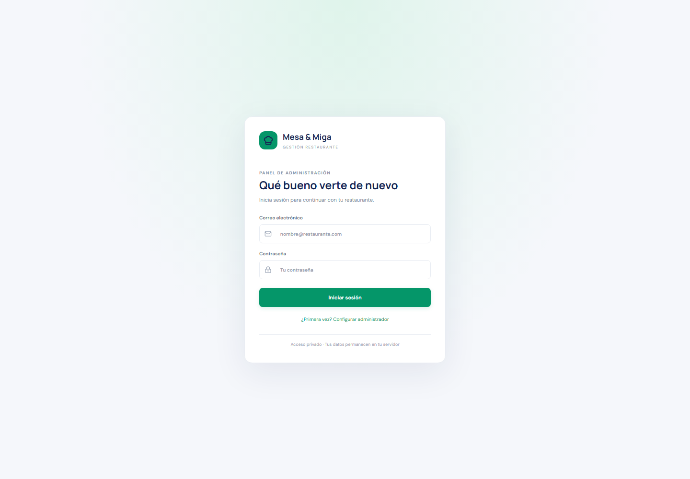
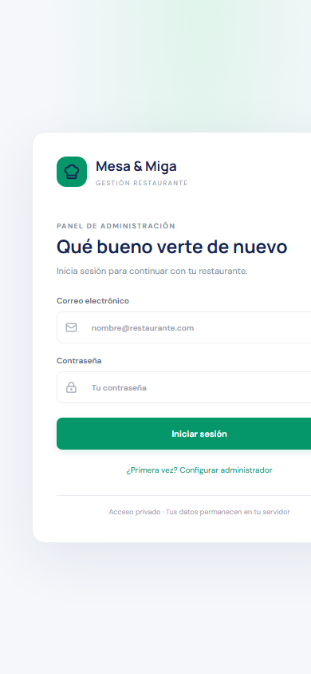

# Mesa & Miga — Sistema de gestión para restaurantes

Aplicación web de gestión para centralizar la operación diaria de un restaurante. Incluye una interfaz responsive en español, API REST en Java y un esquema relacional para MySQL 8. El proyecto está preparado para desarrollo local y para publicación en GitHub.

> **Estado:** versión funcional de portafolio con flujos relacionales conectados para catálogo, mesas, pedidos, recetas de insumos, caja, reportes, empleados y cuentas. Los insumos configurados en una receta se descuentan al entregar el pedido, con validación transaccional de existencias. El despliegue real en MySQL debe validarse en el entorno de destino antes de operar.

## Características

- Inicio de sesión JWT, contraseñas BCrypt y registro seguro de la primera cuenta administradora.
- Gestión de categorías, productos, mesas, cuentas con roles y perfiles de empleados.
- Pedidos con líneas de productos, subtotal/total calculados desde el catálogo y transición validada de estados.
- Entradas/salidas de inventario con historial por usuario, bloqueo de stock negativo y alertas por mínimo.
- Recetas configurables por producto; al entregar el pedido se descuenta automáticamente el consumo definido y se registra como movimiento de inventario. Productos sin receta no generan consumo automático.
- Caja ligada a pedidos entregados, protección ante cobro duplicado y anulación auditada con motivo.
- Dashboard y reportes diarios, semanales y mensuales con ventas reales y productos más vendidos.
- Exportación Excel (.xlsx), CSV compatible e impresión del reporte para guardarlo como PDF.
- Búsqueda, formularios validados, estados visibles, tema claro/oscuro y diseño responsive.
- Esquema MySQL con relaciones, restricciones, índices y script de prueba aislado con H2.

## Tecnologías

- **Frontend:** React 18, TypeScript, Vite, Tailwind CSS, Axios, React Router, Recharts, Lucide, fflate (generación XLSX).
- **Backend:** Java 21, Spring Boot 3, Spring Web, Security, Data JPA, Bean Validation, Maven, JWT.
- **Base de datos:** MySQL 8.

## Requisitos

- Node.js 20.19+ (o 22.12+) y npm.
- JDK 21.
- Maven 3.9+ (Maven Wrapper aún no está incluido).
- MySQL 8.0+ o Docker Compose.

## Inicio rápido

1. Crea una base local y aplica `database/schema.sql` con un usuario de MySQL que tenga permisos sobre la base `restaurante`.
2. Copia `.env.example` a `.env` y define usuario, contraseña y una clave JWT privada de 32 caracteres como mínimo. Spring Boot carga ese archivo para desarrollo local. No subas ese archivo.
3. Inicia el backend desde `backend/`:

   ```powershell
   $env:DB_URL="jdbc:mysql://localhost:3306/restaurante?useSSL=false&allowPublicKeyRetrieval=true&serverTimezone=America/Lima"
   $env:DB_USERNAME="tu_usuario"
   $env:DB_PASSWORD="tu_clave_local"
   $env:JWT_SECRET="una_clave_local_aleatoria_de_32_caracteres_o_mas"
   mvn spring-boot:run
   ```

4. Opcionalmente, copia `frontend/.env.example` a `frontend/.env.local` para definir la URL de la API. En otra terminal, inicia el frontend:

   ```powershell
   cd frontend
   npm install
   npm run dev
   ```

5. Abre <http://localhost:5173>. Selecciona **¿Primera vez? Configurar administrador**, crea la primera cuenta (contraseña de 12 caracteres como mínimo) e inicia sesión.

La API escucha en `http://localhost:8080/api`. Para cambiar el origen, define `VITE_API_URL` en `frontend/.env.local` y `CORS_ORIGIN` para el backend.

### Base de datos con Docker

Define `DB_PASSWORD` y `MYSQL_ROOT_PASSWORD` en el entorno local antes de ejecutar `docker compose up -d mysql`. Compose ejecuta `database/schema.sql` al inicializar el volumen. Los archivos de ejemplo no contienen credenciales válidas.

Para una demostración visual local, después de inicializar el esquema puedes ejecutar `database/demo-data.sql`. Sus categorías, productos, mesa e insumo están marcados con `DEMO`; no son datos de producción.

## API principal

| Método | Ruta | Acceso |
|---|---|---|
| GET | /api/health | Público |
| POST | /api/auth/setup, /api/auth/login | Público; setup solo para la primera cuenta |
| GET/POST/PUT/DELETE | /api/categories | JWT, administrador o encargado |
| GET/POST/PUT/DELETE | /api/products, /api/tables | JWT; escritura administrador/encargado |
| GET/PUT | /api/products/{id}/recipe | JWT; escritura administrador/encargado |
| GET/POST/PUT/DELETE | /api/inventory | JWT; escritura administrador/encargado |
| GET/POST | /api/inventory/{id}/movements | JWT; movimientos e historial |
| GET/POST | /api/orders | JWT |
| PUT | /api/orders/{id}/items | JWT; pedido en curso |
| PATCH | /api/orders/{id}/status | JWT; transiciones validadas |
| GET | /api/sales | JWT |
| POST | /api/sales/orders/{id}/checkout | JWT; pedido entregado, una sola vez |
| POST | /api/sales/{id}/void | JWT, administrador; anulación auditada |
| GET | /api/reports/summary?period=DAILY, WEEKLY o MONTHLY | JWT |
| GET | /api/dashboard/metrics | JWT |
| GET/POST/PUT/DELETE | /api/users | JWT, administrador |
| GET/POST/PUT/DELETE | /api/employees | JWT, administrador o encargado |

POST /api/auth/setup recibe un objeto con name, email y password (mínimo 12 caracteres). Las operaciones comerciales usan las tablas relacionales. business_records se conserva solo para notas sencillas. Configura la receta del producto desde Catálogo > botón de chef; las cantidades se expresan en la unidad definida para cada insumo y se descuentan cuando el pedido pasa a Entregado. Las salidas manuales siguen disponibles en Inventario.

## Estructura

```text
backend/       API Spring Boot organizada por controladores, servicios, entidades y repositorios
database/      Esquema relacional MySQL
docs/          Guías de arquitectura y pruebas
frontend/      Aplicación React por funcionalidades
screenshots/   Destino para capturas reales de la aplicación
```

## Pruebas y compilación

```powershell
cd frontend
npm install
npm run build
npm test

cd ../backend
mvn test
```

La construcción de frontend no necesita el backend ni datos de muestra. Para probar API y persistencia, inicia MySQL y sigue `docs/TECHNICAL.md`.

## Capturas

Capturas reales de la pantalla de acceso, generadas desde el frontend ejecutándose en Chrome:





## Publicación en GitHub

1. Revisa `git status` y confirma que `.env`, claves, contraseñas y datos locales estén ignorados.
2. Crea un repositorio vacío en GitHub.
3. Ejecuta `git init`, `git add .`, `git commit -m "feat: sistema de gestión de restaurante"`.
4. Añade el remoto HTTPS/SSH del repositorio y ejecuta `git push -u origin main`.
5. Configura secretos de despliegue en el gestor de secretos del proveedor; nunca dentro del repositorio.

## Autor

Fernando Alonso Rojas

## Licencia

MIT. Consulta [LICENSE](LICENSE).
